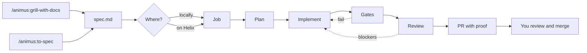

# Animus

A software factory on Claude Code. Feed it a memory (a spec), and it relives
it into a pull request, with proof for every acceptance criterion. You merge.

## Install

On macOS or Linux:

```sh
curl -fsSL https://raw.githubusercontent.com/AKstudios/animus/stable/install.sh | bash
```

On Windows, in PowerShell:

```powershell
irm https://raw.githubusercontent.com/AKstudios/animus/stable/install.ps1 | iex
```

It installs what is missing (git, Node 24, Claude Code, GitHub's `gh`),
asking first, signs you in, and then asks two things: whether Animus may
update itself, and which of your projects to turn it on in. To turn it on in
another project later, run `animus enable` inside it.

Already have Claude Code, Node 24, git and `gh`, all signed in? In Claude
Code:

```
/plugin marketplace add akstudios/animus#stable
/plugin install animus@akstudios
```

Then ask Claude to run `animus doctor`. It lists anything missing.

## Enter the Animus

1. In your repository, run `animus init` once. Check the
   `.animus/animus.yaml` it drafts and commit it.
2. Shape the memory, one of two ways:
   1. `/animus:grill-with-docs`: Claude questions you until the design is
      clear, then writes the spec.
   2. `/animus:to-spec`: you already know what you want; Claude writes the
      spec from the conversation.
3. The job starts on its own. Say "run it locally" or "run it on Helix" to
   choose where.
4. Wait for the PR. Locally, keep the session open; on Helix, you can close
   it.
5. Review the PR and merge.



## The Helix

Helix is the shared machine that runs jobs for the whole team, so your
laptop doesn't have to stay on.

1. Ask whoever runs Helix for an invite, and run the `animus join <url>
   <code>` it gives you.
2. Ask Claude to add your repository to Helix. Helix checks it first, which
   takes a few minutes.
3. Start jobs as above. They go to Helix when it has your repository.
4. Open the Helix address (the `<url>` you joined with) in a browser to
   watch it: running jobs and their stage, the queue, jobs waiting for an
   answer, and jobs that ended. No sign-in needed. If whoever runs Helix
   opened it to the office network, `http://<machine>.local:7420` shows the
   same page without the VPN.
5. Ask Claude how a job is going, or to answer its question.

## Docs

Commands, specs, configuration and how it works: [docs/](docs/README.md).
